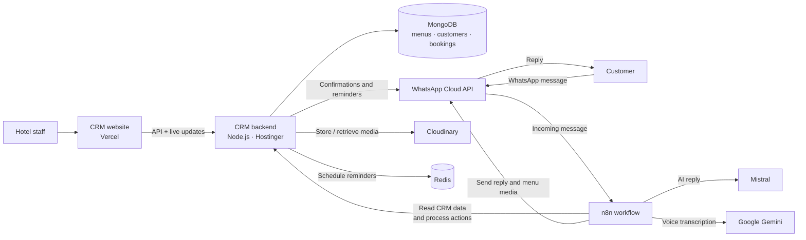

# Hotel CRM — Deployment Architecture

## In plain words

- **Staff:** opens the CRM website. The website gets and saves CRM data through the backend.
- **Customer:** messages the WhatsApp number. Meta sends that message to n8n.
- **n8n:** gets the current menu and booking information from the backend, asks the AI to prepare a reply, then sends it through WhatsApp. Voice messages are transcribed by Gemini.
- **Backend:** saves CRM data in MongoDB, stores uploaded menu files in Cloudinary, and uses Redis for scheduled reminders.

## Where to configure

- [n8n setup](./n8n-workflows/N8N_CREDENTIALS.md) — n8n credentials and its API key.
- [Backend setup](./BACKEND_ENV_SETUP.md) — private backend environment settings.
- [WhatsApp workflow](./n8n-workflows/restaurant-whatsapp-ai-bot.json) — import this workflow into n8n.

The backend URL currently configured in the app and workflow is `https://magenta-yak-337378.hostingersite.com`. MongoDB, Redis, and n8n hosting providers are not specified in the project configuration, so they are shown by service name.
